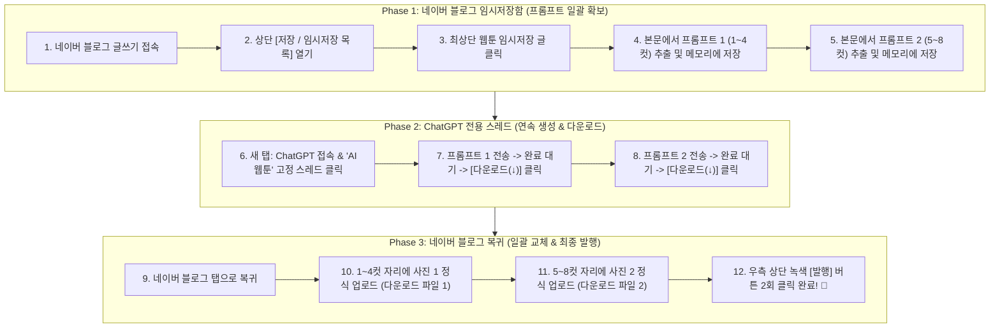

# 🤖 [ASIDE 공식 자동화 가이드 V3 - 최적화 완결판]
## 탭 왕복 없는 원스톱(One-Stop) 웹툰 자동 생성 & 네이버 블로그 발행 매뉴얼

사장님의 칭찬과 승인에 힘입어, 브라우저 탭 간의 불필요한 왕복 이동을 완전히 없앤 **"원스톱 배치(Batch) 프로세스"**로 최종 매뉴얼을 완성하였습니다!

---

## 💡 원스톱 배치(Batch) 방식의 압도적 장점
1. **탭 왕복 제로(Zero)**: 네이버 블로그와 ChatGPT 사이를 왔다 갔다 하지 않고, **`블로그에서 프롬프트 2개 한 번에 추출` ➜ `ChatGPT에서 2장 연속 생성 및 다운로드` ➜ `블로그로 복귀하여 사진 2장 일괄 업로드 & 발행`**으로 3단 단순화!
2. **속도 2배 향상 & 튕김 제로**: 탭 전환 시 발생할 수 있는 포커스 잃음(Blur)이나 에디터 세션 끊김 위험을 원천 차단하여 실행 속도와 안정성이 극대화됩니다.

---

## 🚀 ASIDE 전체 실행 흐름도 (3단계 블록 구조)

---

## 📋 ASIDE 단계별 정밀 실행 지침 (Step-by-Step)

### [PHASE 1: 네이버 블로그에서 프롬프트 2개 한 번에 확보]

#### 1단계 · 네이버 블로그 글쓰기 접속
* **동작**: 네이버 블로그 글쓰기 URL(`https://blog.naver.com/jcjung1401/postwrite?categoryNo=7`)로 이동합니다.
* **조건부 동작**: 만약 "작성 중인 글이 있습니다. 이어서 작성하시겠습니까?" 팝업이 뜨면 **[확인]**을 클릭하여 즉시 본문을 엽니다 (이 경우 2~3단계 건너뜀).

#### 2단계 · 임시저장 목록 열기
* **동작**: 에디터 상단 우측의 **[저장 (숫자)]** 버튼(`button.se-toolbar-item-save, button[class*="save_btn"]`)을 클릭합니다.

#### 3단계 · 최신 웹툰 글 불러오기
* **동작**: 우측 임시저장 사이드 패널 맨 위의 **가장 최신 글**을 클릭하여 본문을 로드합니다.

#### 4단계 · 1~4컷 및 5~8컷 프롬프트 일괄 추출 (핵심!)
* **동작 1**: 본문에서 `[CHATGPT 컷 1~4 복사 시작]`과 `[CHATGPT 컷 1~4 복사 끝]` 사이의 텍스트를 추출하여 변수 **`PROMPT_1`**에 저장합니다.
* **동작 2**: 본문에서 `[CHATGPT 컷 5~8 복사 시작]`과 `[CHATGPT 컷 5~8 복사 끝]` 사이의 텍스트를 추출하여 변수 **`PROMPT_2`**에 저장합니다.
* *(Aside 변수/클립보드에 2개의 프롬프트가 모두 확보되었으므로, 이제 블로그 탭을 떠나도 됩니다!)*

---

### [PHASE 2: ChatGPT에서 2장 연속 생성 및 다운로드]

#### 5단계 · ChatGPT 접속 및 'AI웹툰' 스레드 클릭
* **동작**: 새 탭을 열어 `https://chatgpt.com`에 접속합니다.
* **동작**: 좌측 사이드바에서 이미 사장님의 캐릭터 시트가 학습된 **`AI웹툰`** 스레드를 클릭합니다.

#### 6단계 · 1세트(1~4컷) 이미지 생성 & 다운로드
* **동작**: 입력창에 저장해 둔 **`PROMPT_1`**을 붙여넣고 Enter를 누릅니다.
* **대기**: ChatGPT가 4분할 이미지를 완성하고 **다운로드 아이콘(↓)**이 뜰 때까지 대기합니다.
* **동작**: **[다운로드]** 버튼을 클릭하여 첫 번째 만화 파일을 PC에 저장합니다 (보통 `DALL-E...png` 형식).

#### 7단계 · 2세트(5~8컷) 이미지 생성 & 다운로드 (연속 실행!)
* **동작**: 같은 입력창에 곧바로 저장해 둔 **`PROMPT_2`**를 붙여넣고 Enter를 누릅니다.
* **대기**: 두 번째 4분할 이미지가 완성될 때까지 대기합니다.
* **동작**: **[다운로드]** 버튼을 클릭하여 두 번째 만화 파일을 PC에 저장합니다.
* *(ChatGPT 작업 100% 완료! PC 다운로드 폴더에 만화 컷 2장이 모두 준비되었습니다!)*

---

### [PHASE 3: 네이버 블로그로 복귀하여 사진 정식 업로드 & 최종 발행]

#### 8단계 · 네이버 블로그 탭으로 복귀
* **동작**: 열려 있던 네이버 블로그 글쓰기 탭으로 다시 전환합니다.

#### 9단계 · [사진 1] 위치에 1~4컷 이미지 정식 업로드
* **동작**: 1컷 대본 바로 윗부분(기존 `[CHATGPT 컷 1~4...]` 안내 문구가 있던 자리)을 클릭하여 프롬프트 텍스트를 삭제(Backspace/Delete)합니다.
* **동작**: 상단 툴바의 **[사진]** 버튼(`button.se-image-toolbar-button`)을 클릭합니다.
* **동작**: 파일 선택 창에서 다운로드 폴더의 **첫 번째 만화 컷 파일**을 선택하여 정식 업로드합니다.

#### 10단계 · [사진 2] 위치에 5~8컷 이미지 정식 업로드
* **동작**: 4컷 대본과 5컷 대본 사이(기존 `[CHATGPT 컷 5~8...]` 안내 문구가 있던 자리)를 클릭하여 프롬프트 텍스트를 삭제합니다.
* **동작**: 상단 툴바의 **[사진]** 버튼을 클릭합니다.
* **동작**: 파일 선택 창에서 다운로드 폴더의 **두 번째 만화 컷 파일**을 선택하여 정식 업로드합니다.

#### 11단계 · 최종 원클릭 발행
* **동작 1**: 화면 우측 상단의 녹색 **[발행]** 버튼을 클릭합니다.
* **동작 2**: 발행 옵션 패널이 열리면, 하단의 녹색 **[발행]** 버튼을 한 번 더 클릭합니다.
* **완료**: 🎉 에러 없이 완벽한 3D 웹툰 포스팅이 실시간으로 공개 발행됩니다!
